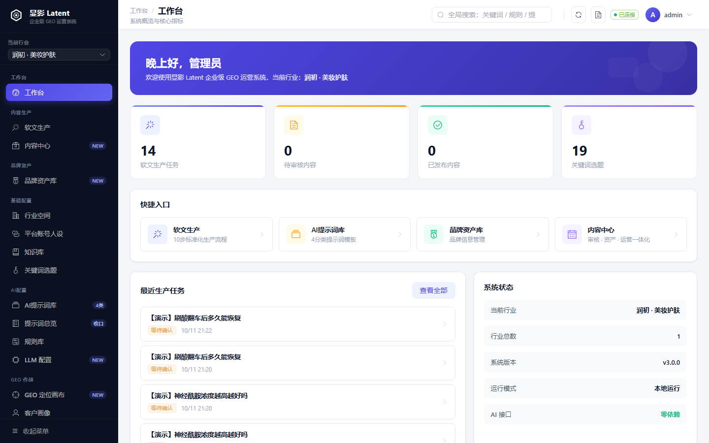
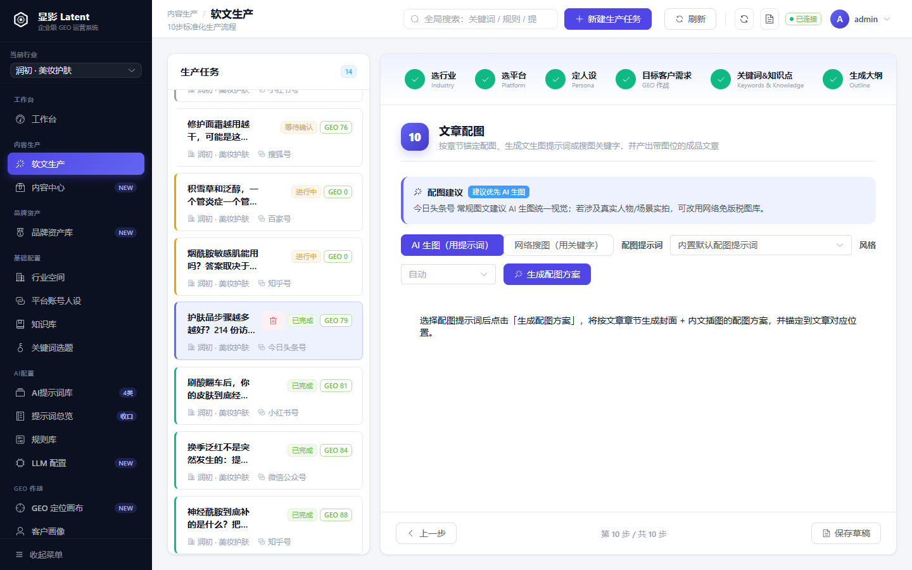
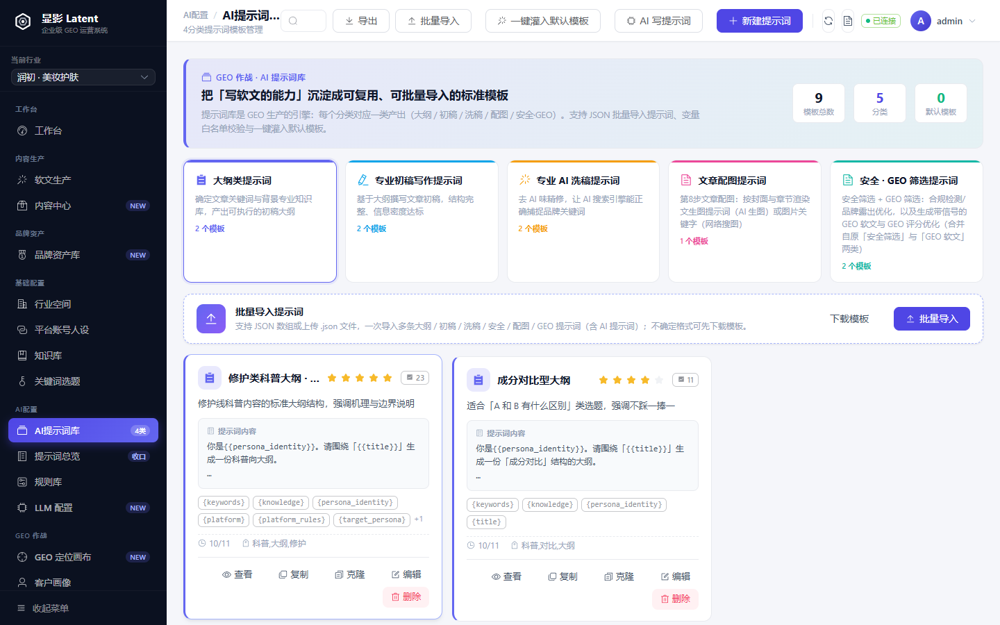
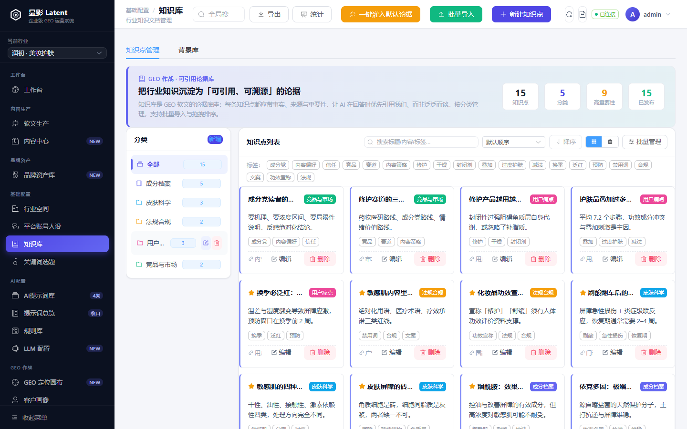
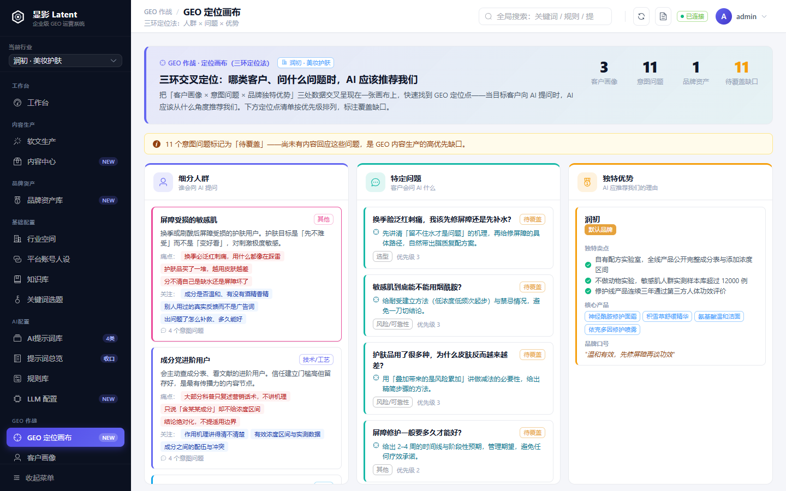
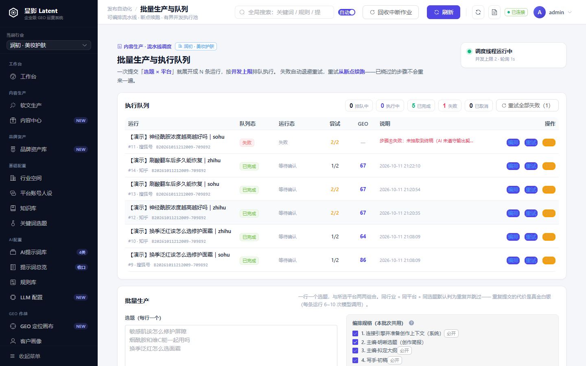
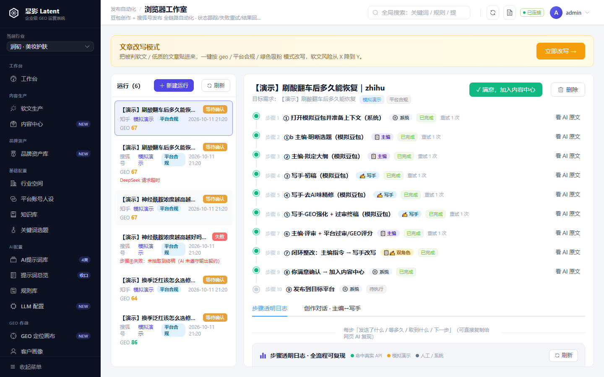
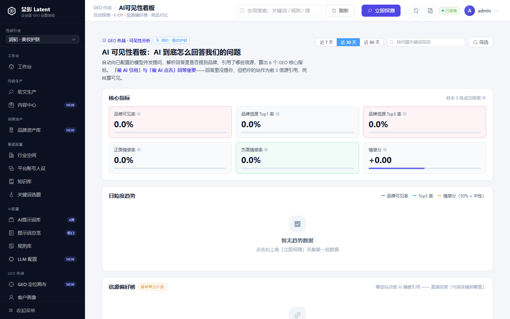
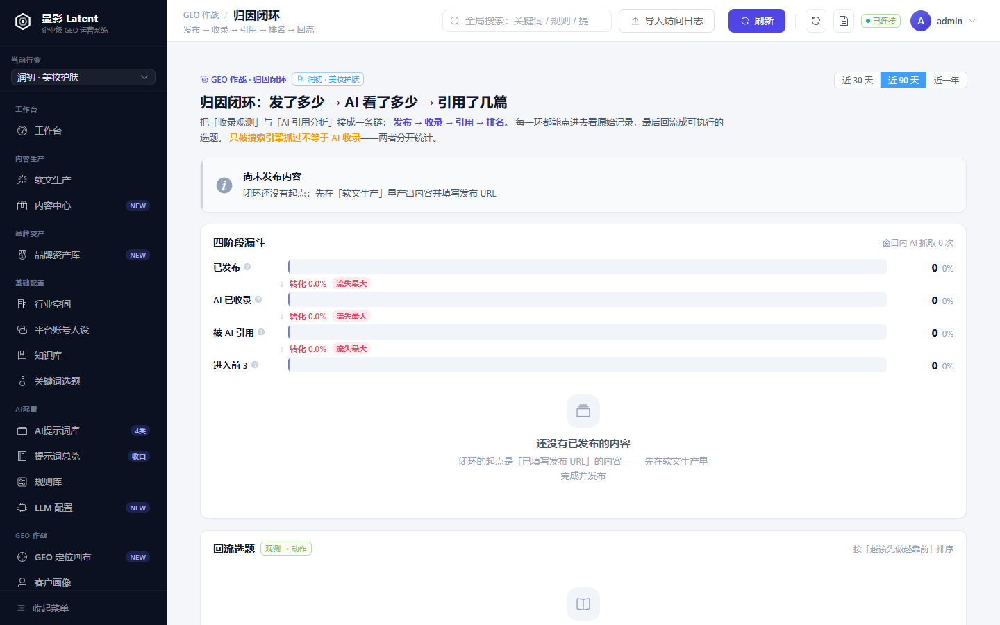

# 显影 Latent

> 企业级 GEO 运营系统：让品牌从潜影到显影，在 AI 的答案里被看见、被引用。

面向品牌内容运营团队的 **内容生产流水线 + AI 可见性闭环**：把「行业空间 → 平台/账号/人设 → 关键词 → 知识库 → 提示词 → 内容生产 → 质检闸门 → 多平台发布 → AI 收录监测 → 引用归因 → 选题回流」串成一条可复用、可追溯、可度量的链路。

[](LICENSE)
[](UPGRADE-V3.md)
[](https://www.python.org/)
[](https://fastapi.tiangolo.com/)
[](https://vuejs.org/)

---

## 目录

- [它解决什么问题](#它解决什么问题)
- [核心特性](#核心特性)
- [界面预览](#界面预览)
- [技术栈](#技术栈)
- [安全设计](#安全设计)
- [快速开始](#快速开始)
- [配置 LLM](#配置-llm)
- [品牌配置](#品牌配置)
- [使用流程](#使用流程)
- [三种发布模式](#三种发布模式)
- [提示词变量体系](#提示词变量体系)
- [项目结构](#项目结构)
- [数据模型](#数据模型)
- [测试](#测试)
- [工程约定与验收](#工程约定与验收)
- [打包为可执行文件](#打包为可执行文件)
- [常见问题](#常见问题)
- [贡献](#贡献)
- [开源协议](#开源协议)

---

## 它解决什么问题

内容团队做「AI 批量写稿」时，通常会在三件事上翻车：

1. **资产散** — 关键词、知识库、品牌资料、提示词散落在各个文档和聊天记录里，换个账号就要重新找一遍。
2. **不可控** — 直接把提示词丢给大模型，产出忽好忽坏，品牌信息要么漏掉、要么硬植入到过不了平台审核。
3. **不可追溯** — 一篇文章从大纲到终稿改了哪几步、用了哪版提示词，事后完全说不清。

本系统把这三件事收敛进一个**按行业隔离**的工作台：所有内容资产结构化沉淀，提示词用变量占位符与业务数据解耦，生产流程拆成 10 个可回填、可回看的步骤；批量生产走**有界并发队列**，失败自动退避重试并支持断点续跑。

---

## 核心特性

### 内容资产

| 模块 | 能力 |
| --- | --- |
| **行业空间** | 顶层隔离实体，所有业务数据挂靠行业，互不干扰 |
| **平台 / 账号 / 人设** | 平台字数与合规等级、账号定位、人设身份与语气规则 |
| **关键词** | 关键词与关键词组管理，供生产时勾选 |
| **知识库** | 分类（图标/颜色/描述）+ 知识点（摘要/来源/重要性/状态/标签）、统计面板、JSON/CSV 导出、批量导入、按分类分组浏览、全文搜索、详情抽屉 |
| **AI 提示词库** | 4 分类（大纲/初稿/洗稿/安全）、三栏编辑器（变量面板 + 编辑器 + 实时预览）、自定义变量、使用次数追踪、0-5 星评分、JSON 导入导出 |
| **规则库** | 去 AI 味规则 / 合规规则 / AI SEO 规则三大类，可组合挂载到任务 |
| **品牌资产** | 品牌名、官网、联系方式、口号、核心产品、卖点、品牌故事 |
| **客户画像 / 意图问题** | GEO 作战用：目标客户角色、痛点、关注点，以及「目标客户会问 AI 的问题」 |

### 生产与发布

| 模块 | 能力 |
| --- | --- |
| **软文生产** | 10 步标准化流程（见下），每步可回填、可回看 |
| **批量生产与执行队列** | 一次提交「多个选题 × 多个平台」，展开成 N 条运行并按**有界并发**排队执行；失败自动退避重试、新尝试从断点续跑、排队中可取消 |
| **质检闸门** | claim 抽取 → 证据核对 → 三态决策（通过 / 待人工确认 / 驳回），把「AI 说得好听」挡在发布之前 |
| **内容中心** | 成稿归档、版本管理与内容资产沉淀 |
| **发布管理** | 发布任务与发布策略编排；平台合规策略按 `publish_mode` 播种 |
| **浏览器工作室** | 浏览器自动化流水线：豆包 Web 对话创作 → 回传存档 → 搜狐号自动发布（无官方 API 时最稳的路径） |
| **自动化提示词** | 可复用的提示词编排单元 |

### GEO 闭环

| 模块 | 能力 |
| --- | --- |
| **GEO 定位画布** | 三环定位法（细分人群 × 特定问题 × 独特优势），自动标注尚未覆盖的意图缺口 |
| **GEO 监控** | 追踪品牌在 AI 回答中的收录与提及情况 |
| **AI 可见性看板** | 自动采集品牌在 AI 回答里的出现情况，6 项 KPI + 趋势曲线 + 信源偏好榜 |
| **归因闭环** | 四阶段漏斗 + 内容旅程回溯 + 回流选题，把「被引用」反推回「下一篇写什么」 |
| **爬虫与站点资产** | AI / 搜索引擎爬虫抓取行为分类统计，一键生成 `llms.txt` 与 `sitemap.xml` |

---

## 界面预览

> 以下截图取自系统实际运行界面，数据为**通用示例**（虚构的美妆护肤品牌「润初」），与任何真实客户无关。
>
> 截图可复现：`backend/scripts/seed_demo.py` 往一个**独立的演示库**灌入这套虚构数据
> （不碰开发库），再由 `frontend/scripts/shot-readme.mjs` 逐页截取。

### 工作台

系统概览与核心指标：软文生产任务、待审核 / 已发布内容、关键词选题，以及最近生产任务与运行状态。



### 软文生产：10 步标准化流程

从「选行业 → 选平台 → 定人设 → 目标客户需求 → 关键词 & 知识点 → 生成大纲」到「初稿 → 精修 → 安全·GEO 筛选 → 文章配图」，每步独立状态、可回看、可重试。



### AI 提示词库

5 类提示词模板（大纲 / 初稿 / 洗稿 / 配图 / 安全·GEO），支持 JSON 批量导入、变量白名单校验与一键灌入默认模板。



### 知识库

把行业知识沉淀为「可引用、可溯源」的论据：按分类管理，每条知识点带标签、来源与重要性，供 AI 创作时优先引用。



### GEO 定位画布

三环定位法（细分人群 × 特定问题 × 独特优势）：在画布上快速找到 GEO 定位点，并自动标注缺口（尚未覆盖的意图问题）。



### 批量生产与执行队列

一次提交多个选题，系统展开成 N 条运行并按并发上限排队；**调度状态与内容状态分开显示**，失败可单独重试或整批重试。



### 浏览器工作室

无官方 API 的平台也能发：豆包 Web 对话负责创作，搜狐号自动发布负责落地，每一步都留痕可回溯。



### AI 可见性看板

品牌在 AI 回答里被提到了几次、被谁提到、信源是哪些站点 —— 6 项 KPI + 趋势曲线 + 信源偏好榜。



### 归因闭环

从「曝光 → 提及 → 引用 → 转化」四阶段漏斗回溯到具体内容，再反推出下一篇该写什么。



---

## 技术栈

| 层 | 选型 |
| --- | --- |
| 后端 | FastAPI 0.115 · SQLAlchemy 2.0 · Pydantic 2 · Uvicorn |
| 数据库 | SQLite（单文件，零安装零服务） |
| 数据迁移 | Alembic（版本化 schema 迁移） |
| 鉴权 | 自实现 HS256 JWT + PBKDF2-HMAC-SHA256（零第三方依赖） |
| 密钥保护 | Fernet 字段级加密（SQLAlchemy TypeDecorator 透明加解密） |
| 前端 | Vue 3.5 · Vite 5 · Element Plus 2.8 · Pinia · Vue Router |
| 前端类型 | TypeScript 5.9（**渐进式**：新文件写 `lang="ts"`，存量 `.js` 走 `allowJs` 不参与检查） |
| 代码检查 | `ruff check`（Python，0 告警门禁）· `vue-tsc --noEmit`（类型检查） |
| 前端验收 | Playwright 脚本（冒烟 / 截图 / **结构断言**）+ 自研设计令牌审计脚本 |
| 浏览器自动化 | Playwright（可选依赖，未安装时优雅降级） |
| 打包 | PyInstaller（后端）、Vite build（前端） |

---

## 安全设计

v3 补齐了 v2 缺失的安全底座，这是本项目与「本地脚本拼凑」的分界线。

### 鉴权

- **除 `/api/auth/login` 与 `/api/meta` 外，所有接口都要求登录**。
  守卫在 `main.py` 注册路由时统一挂载，新增路由若忘了加 `_PROTECTED_ROUTERS`
  会被 `tests/test_auth_api.py` 的参数化用例拦下。
- 令牌为 HS256 JWT，默认有效期 12 小时（`APP_TOKEN_TTL` 可调）。
- 签名密钥自动生成并落盘 `backend/data/.secret_key`，也可用 `APP_SECRET_KEY` 指定。
- 密码用 PBKDF2-HMAC-SHA256（26 万轮 + 16 字节随机盐），
  并**兼容 v2 的无盐 SHA-256**：老用户首次登录成功后自动升级，无需改密。
- 登录失败限流（同 IP 5 分钟内 10 次），且不区分「用户不存在」与「密码错误」以防账号枚举。
- 系统强制保留至少一个启用的管理员，避免把自己锁死。

### 密钥保护

- `llm_config.api_key` 与 `platform_credential.cred_json` 在 SQLite 中**以密文存储**，
  由 `EncryptedText` 在读写边界透明加解密，业务代码无感知。
- 加密密钥存 `backend/data/.fernet_key`（0600），可用 `APP_FERNET_KEY` 覆盖。
  ⚠️ 更换密钥会导致已加密数据无法解密，需重新录入密钥与凭据。
- 启动时幂等迁移，把 v2 遗留的明文存量刷成密文。

### 其他

- CORS 默认只放行本地开发端口，不再通配。
- 操作日志（登录、改密、用户增删改）落 `operation_log` 表，管理员可查询。
- 权限模型：`admin`（全部）与 `editor`（按 `industry_perms` 限定行业）。


---

## 快速开始

### 环境要求

- Python **3.9+**（开发环境为 3.11）
- Node.js **18+**
- npm 或 pnpm

### 方式一：一键启动（推荐）

```bash
# Linux / macOS
bash start.sh

# Windows
start.bat
```

### 方式二：手动启动

```bash
# 终端 1 —— 后端
cd backend
python -m venv venv
venv/Scripts/activate        # Linux/macOS: source venv/bin/activate
pip install -r requirements.txt
python run.py                # http://127.0.0.1:8765

# 终端 2 —— 前端
cd frontend
npm install
npm run dev                  # http://localhost:5173
```

打开 `http://localhost:5173`，默认账号 **admin / admin123**。

> ⚠️ **首次登录后请立即修改默认密码**（顶栏用户菜单 → 修改密码）。
>
> 系统默认只监听 `127.0.0.1`。若改为 `0.0.0.0` 暴露到局域网，**务必先设置
> `APP_SECRET_KEY` 并修改管理员密码** —— 否则同网段任何人都能读写全部数据。

### 首次使用

1. 在左侧创建或选择一个**行业空间**
2. 依次配置：平台 → 账号 → 人设 → 关键词 → 知识库 → 提示词库
3. 进入**软文生产**，新建任务并按 10 步流程操作

> 本仓库**不包含数据库文件**。首次启动时后端会自动建表并创建一个空库，无需手动初始化。

---

## 配置 LLM

系统通过 OpenAI 兼容接口调用大模型，需在界面中自行配置密钥：

1. 进入「设置 → LLM 配置」
2. 新增配置，填写 `provider` / `api_key` / `base_url` / `model`
3. 可配置多条并分配不同 `role`（如 `research` 用于选题调研、`writing` 用于正文撰写、`review` 用于审核整改）

密钥仅保存在本地 SQLite 中，不会外传。**请勿将带有真实密钥的 `backend/data/` 目录提交到版本库**（已在 `.gitignore` 中排除）。

---

## 品牌配置

系统把品牌信息（品牌名、官网、地域）从源码中抽离为**统一配置**，因此**开源版与客户定制版共用同一份代码** —— 客户切换品牌时无需改动任何源码。

配置优先级（高 → 低）：

1. **环境变量** — `BRAND_NAME` / `BRAND_FULL_NAME` / `BRAND_PRODUCT` / `BRAND_OFFICIAL_SITE_URL` / `BRAND_REGION` / `BRAND_REGION_CITY` / `BRAND_ALIASES`
2. **配置文件** `brand.config.json` — 放在项目根目录或 `backend/` 目录均可
3. **内置默认值** — 不配置时使用通用示例值

最快的方式是复制模板再改：

```bash
cp brand.config.json.example brand.config.json
```

```json
{
  "brand_name": "你的品牌",
  "brand_full_name": "你的品牌科技有限公司",
  "brand_product": "核心产品线",
  "official_site_url": "https://www.your-site.com",
  "region": "华东",
  "region_city": "上海",
  "brand_aliases": ["品牌简称", "产品简称"]
}
```

| 字段 | 说明 | 默认值 |
| --- | --- | --- |
| `brand_name` | 品牌名（用于提示词与软文特征检测） | `示例品牌` |
| `brand_full_name` | 品牌全称（用于官网 MDX 编辑角色设定） | `示例品牌科技有限公司` |
| `brand_product` | 核心产品线名 | `示例产品` |
| `official_site_url` | 官网 / 自建站地址（MDX 模式注入） | `https://www.example.com` |
| `region` | 所在区域 / 省份（用于提示词地域示例） | `华东` |
| `region_city` | 所在城市 | `上海` |
| `brand_aliases` | 品牌 / 产品别名（软文特征检测用），留空则自动取前两项 | 自动推导 |

> `brand.config.json` 已在 `.gitignore` 中排除，**不会进仓库**；请勿把真实品牌信息硬编码回源码。
>
> 配置在进程启动时读取一次，修改后需**重启后端服务**才生效。

---

## 使用流程

**软文生产 10 步工作流**：

| 步骤 | 内容 |
| --- | --- |
| 1 | **选择行业** — 确定本次生产所属的行业空间 |
| 2 | **选择发布平台** — 平台决定字数区间、合规等级与内容调性 |
| 3 | **确定人设账号** — 绑定发布账号与内容人设 |
| 4 | **确定目标客户需求** — GEO 作战：定义目标客户会问 AI 的问题与期望推荐角度 |
| 5 | **选择关键词 & 知识点** — 三栏布局：左栏选关键词、中栏选知识点、右栏生成大纲 |
| 6 | **生成大纲** — 选择大纲提示词，产出可执行的结构化大纲 |
| 7 | **初稿写作** — 选择初稿提示词，生成正文初稿 |
| 8 | **洗稿精修** — 选择洗稿提示词，去 AI 味精修 |
| 9 | **安全发布 & GEO 筛选** — 合规自检 + GEO 评分，一步到位出终稿 |
| 10 | **文章配图** — 按章节锚定配图，生成文生图提示词或搜图关键字 |

每步生成结果后回填系统，下一轮渲染会把上一步产物作为变量注入（如 `{outline_content}` → `{draft_content}` → `{rewrite_content}`）。

---

## 三种发布模式

生产任务可指定发布模式，不同模式会注入不同的品牌策略与文章目标：

| 模式 | 适用阵地 | 品牌策略 |
| --- | --- | --- |
| **`geo`** | 自建站 / 官网 | 强品牌。以公司为主体，品牌名全文至少出现 3 次，追求被 AI 检索与推荐引用 |
| **`platform`** | 内容平台（搜狐号、知乎等） | 中立合规。第三方视角，品牌自然提及 ≤ 2 次，标题不含品牌名，文末标注 AIGC 声明 |
| **`green`** | 自媒体账号 | 纯干货涨粉。不带软文营销，品牌仅「彩蛋式」轻提 ≤ 2 次 |

当平台 `output_format = "mdx"`（如官网/自建站）时，系统按 MDX 模板产出可直接粘贴的文章代码：固定 frontmatter + 六段结构 + 4 列数据对比表 + 引用块，禁止 `<Image />` 组件与 emoji。

---

## 提示词变量体系

提示词模板中用 `{variable_name}` 引用业务数据，避免硬编码。系统提供 **66 个内置变量**（前端面板展示），渲染引擎支持 **76 个变量键**。

| 分组 | 变量示例 | 说明 |
| --- | --- | --- |
| 行业与平台 | `{industry_name}` `{platform_name}` `{compliance_level}` `{current_date}` | 行业与平台上下文 |
| 账号与人设 | `{account_name}` `{persona_identity}` `{persona_tone}` | 账号定位与人设语气 |
| 品牌信息 | `{brand_name}` `{brand_official_url}` `{core_products}` `{selling_points}` `{brand_story}` | 品牌资产全量字段 |
| 关键词与知识 | `{keywords}` `{keyword_list}` `{knowledge_content}` `{knowledge_items}` `{knowledge_count}` | 关键词与知识库内容 |
| 生产内容 | `{outline_content}` `{draft_content}` `{rewrite_content}` `{final_content}` `{task_title}` | 工作流各步产物 |
| 配图专用 | `{section_title}` `{section_content}` `{aspect_ratio}` `{image_size}` `{style_label}` | 按章节拆分配图 |
| 规则约束 | `{anti_ai_rules}` `{compliance_rules}` `{ai_seo_rules}` `{creation_rules}` | 规则库注入 |
| 字数要求 | `{word_min}` `{word_max}` `{platform_word_min}` `{platform_word_max}` | 字数约束 |
| GEO 作战 | `{target_persona_name}` `{target_persona_pain_points}` `{intent_question}` `{geo_signals}` | 目标客户画像与 AI 意图问题 |

除内置变量外，提示词还可定义**自定义变量**（名称 / 描述 / 默认值 / 是否必填），渲染时用 `custom_vars` 覆盖。

> 提示词编写规范详见 [`docs/提示词编写规范与优化清单.md`](docs/提示词编写规范与优化清单.md)。

---

## 项目结构

```
.
├── backend/                    # FastAPI 后端
│   ├── app/
│   │   ├── main.py             # 应用入口：路由注册 + 鉴权挂载 + 启动编排
│   │   ├── models.py           # SQLAlchemy 模型 + 平台预设
│   │   ├── database.py         # SQLite 连接与会话（支持 APP_DB_PATH）
│   │   ├── security.py         # 密码哈希（PBKDF2）+ 访问令牌（HS256 JWT）
│   │   ├── deps.py             # 请求级鉴权依赖 + 操作日志
│   │   ├── crypto.py           # 字段级加密（Fernet + TypeDecorator）
│   │   ├── dbmigrate.py        # Alembic 编程式驱动（启动自动升级 schema）
│   │   ├── datamigrate.py      # 数据级迁移（敏感字段加密、历史数据归一）
│   │   ├── selfcheck.py        # 启动自检
│   │   ├── version.py          # 版本号单一事实来源
│   │   ├── constants.py        # 内置变量单一事实来源
│   │   ├── brand_config.py     # 品牌配置单一事实来源（brand.config.json / 环境变量）
│   │   ├── paths.py            # 源码/打包双模式路径解析
│   │   ├── routers/            # 27 个路由模块（含 auth），281 个端点
│   │   └── services/           # 提示词渲染、编排内核、队列、批量、GEO 闭环、LLM、发布、合规
│   │       ├── pipeline.py     # 声明式九步规格 + 断点续跑判定
│   │       ├── task_queue.py   # 有界并发调度器 + pipeline_job
│   │       ├── batch.py        # 批量生产：规格展开 + 去重预览
│   │       ├── geo_loop.py     # 可见性归因闭环：四阶段漏斗 + 回流选题
│   │       └── ...             # 质检闸门、可见性采集、发布策略、规则检查等
│   ├── alembic/                # 数据库版本化迁移（baseline + 增量）
│   ├── tests/                  # pytest 测试（402 项，自带临时库隔离）
│   ├── scripts/                # 演示数据种子（seed_demo.py 等，非运行时依赖）
│   ├── migrations/             # v2 时期的一次性数据迁移脚本（保留备查）
│   ├── run.py                  # 启动入口（兼 PyInstaller 打包入口）
│   ├── requirements.txt        # 核心依赖
│   ├── requirements-optional.txt  # 可选依赖（Playwright）
│   └── requirements-dev.txt    # 开发/测试依赖
├── frontend/                   # Vue 3 前端
│   ├── src/
│   │   ├── views/              # 25 个页面；大页面按「壳 + 面板 + 弹窗 + 共享样式」拆到子目录
│   │   ├── components/         # 跨页面通用组件（layout / content / knowledge / production）
│   │   ├── constants/          # 纯数据与标签映射（平台码、状态枚举、图标、生产步骤…）
│   │   ├── composables/        # 可复用逻辑（变量检测、生产流程状态机…）
│   │   ├── utils/              # 纯函数（剪贴板、Markdown、日期、下载、按 id 查找）
│   │   ├── api/                # 接口封装
│   │   ├── store/              # Pinia 状态
│   │   ├── router/             # 路由与导航分组（菜单由路由派生，单一来源）
│   │   └── styles/             # 设计令牌与全局样式
│   ├── scripts/                # 冒烟 / 截图 / 结构断言 / 设计令牌审计脚本
│   └── tests/
├── docs/                       # 设计与规范文档（含前端验收手册、工程约定手册）
├── brand.config.json.example   # 品牌配置模板（复制为 brand.config.json 使用）
├── start.sh / start.bat        # 一键启动
├── init_env.sh / init_env.bat  # 环境初始化
└── build_exe.bat               # 打包脚本
```

---

## 数据模型

核心表共 **38 张**（SQLite）：

| 分组 | 表 | 说明 |
| --- | --- | --- |
| 空间与账号 | `industry` | 行业空间（顶层隔离实体） |
| | `platform` / `account` / `persona` | 平台、账号、人设 |
| 内容资产 | `keyword_group` / `keyword` / `topic` | 关键词组、关键词、选题池 |
| | `knowledge_category` / `knowledge_item` | 知识库分类与知识点 |
| | `prompt_library_item` / `rule_library` / `automation_prompt` | 提示词库、三大规则库、自动化提示词 |
| | `brand_asset` / `background_library` | 品牌资产、背景素材库 |
| GEO 作战 | `target_persona` / `intent_question` | 目标客户画像与意图问题 |
| 生产 | `production_task` / `content_asset` / `content_version` | 生产任务、内容资产与版本 |
| | `pipeline_job` | 队列调度作业（与 `production_task.status` **分开**，避免批次进度算重） |
| | `quality_check` | 质检闸门：claim 抽取与三态决策结果 |
| 发布 | `publish_job` / `publish_strategy` / `platform_credential` | 发布任务、平台合规策略与平台凭据（凭据字段加密落库） |
| | `effect_record` | 发布后的效果回流记录 |
| 可见性 | `geo_monitor` / `geo_monitor_reply` | GEO 收录监控与 AI 回复明细 |
| | `geo_visibility_run` / `geo_visibility_source` | 可见性采集批次与信源 |
| | `geo_visibility_competitor` / `geo_visibility_competitor_detection` | 竞品配置与识别结果 |
| | `crawler_hit` | AI / 搜索引擎爬虫抓取日志 |
| 浏览器自动化 | `browser_studio_step` | 工作室步骤状态机（运行主体已并入 `production_task(mode='auto')`） |
| | `browser_studio_run` | ⚠️ **P2 并表遗留表**，仅供读取未迁移的历史运行；代码统一走 `get_auto_run()` 解析 |
| 系统 | `sys_user` / `operation_log` | 系统用户与操作日志 |
| | `llm_config` / `llm_call_log` | LLM 配置（`api_key` 加密）与调用日志 |

Schema 由 **Alembic** 管理：`backend/app/main.py` 的 `init_db()` 在启动时依次执行
`schema 迁移（upgrade_to_head）→ 数据迁移（run_data_migrations）→ 种子数据`，
无需手动执行 SQL。**新增表结构一律走 `backend/alembic/versions/`，不要再往启动钩子里加 `PRAGMA` / `ALTER TABLE`。**

---

## 测试

后端 **402 项** pytest 用例（22 个文件）：

```bash
cd backend
./venv/Scripts/python.exe -m pytest tests/ -q     # Linux/macOS: ./venv/bin/python -m pytest
./venv/Scripts/python.exe -m pytest tests/ --cov=app --cov-report=term-missing   # 带覆盖率
```

> 测试自带隔离：`tests/conftest.py` 在导入 `app` 之前把数据库指向临时目录
> （并设 `APP_PIPELINE_WORKER=0` 关掉调度线程，避免后台线程与用例抢作业），
> 因此跑测试**不会碰你的开发库** `backend/data/database.db`。

重点测试文件：

| 文件 | 覆盖内容 |
| --- | --- |
| `test_auth_api.py` | 未登录一律 401、令牌伪造拒绝、登录限流、用户 CRUD、最后一个管理员保护、**每个业务路由都已挂守卫** |
| `test_security.py` | 密码加盐、历史 SHA-256 兼容、JWT 篡改与过期 |
| `test_crypto.py` | 加密往返、明文兼容、**落库是密文 / ORM 读出来是明文** |
| `test_pipeline_queue.py` | 断点续跑语义（只跳连续前缀、`done ≠ 产物可用`、`connect` 不阻塞）、有界并发、取消与重投 |
| `test_quality_gate.py` / `test_claim_extractor.py` | 质检闸门三态决策与 claim 抽取 |
| `test_visibility.py` / `test_visibility_analytics.py` | 可见性采集与 6 项 KPI 计算 |
| `test_geo_loop.py` | 归因闭环四阶段漏斗与回流选题 |
| `test_account_api.py` | 含「外键列不得有标量默认值」的遍历式护栏（拦住一类必然 500 的缺陷） |

代码检查：

```bash
pip install ruff
ruff check .          # 在仓库根目录执行，必须 0 告警
```

前端验证脚本：

```bash
cd frontend
npm run smoke             # 冒烟（**会先登录**，否则路由守卫会把每条路由重定向到登录页）
npm run typecheck         # vue-tsc 类型检查
npm run audit:tokens      # 设计令牌审计：未定义且无 fallback 的 var(--x) 必须为 0
npm run test:backend      # 后端接口连通性
npm run test:frontend     # 组件测试
npm run build:check       # 后端测试 + 构建 + 冒烟 全链路
```

截图与结构断言脚本（`frontend/scripts/shot-*.mjs`）不只截图，还断言「详情面板真的渲染了内容」
（非空详情容器数、流水线步骤数、模式徽标的计算样式等）—— 组件拆出去后若 prop 没传进来，
页面会**静默**显示空状态，那也是一张「正常」的截图。**新增任何检查项，都先用一个故意的错误证明它会红。**

---

## 工程约定与验收

这个项目把「踩过的坑」沉淀成了可执行的护栏，而不是写在文档里靠自觉。两份手册是改代码前该先读的东西：

| 文档 | 内容 |
| --- | --- |
| [`docs/工程约定手册.md`](docs/工程约定手册.md) | 鉴权挂载点、加密字段、Alembic 迁移、外键默认值、版本号单一来源、流水线语义等**硬约定**及违反后的后果 |
| [`docs/前端验收手册.md`](docs/前端验收手册.md) | 冒烟 / 截图 / 结构断言 / 计算样式 / 令牌审计的做法与陷阱（滚动容器、弹窗计数、CRLF、假绿…） |
| [`docs/提示词编写规范与优化清单.md`](docs/提示词编写规范与优化清单.md) | 四段式结构、变量覆盖清单与常见反模式 |

几条贯穿全仓的原则：

- **单一事实来源**：版本号只在 `app/version.py`；内置变量只在 `app/constants.py`；菜单只在路由表；
  平台码与状态标签只在前端 `constants/`。任何「第二份」都是缺陷。
- **schema 变更必须走 Alembic**，存量数据刷写放在幂等的 `app/datamigrate.py`。
- **护栏必须有牙齿**：每条断言都先用一个故意的错误验证过它会失败。绿而无检查能力的测试
  比红灯更危险 —— 本项目在这一点上吃过亏，所以现在新加检查项前先证明它会红。
- **样式只能靠计算样式验**：非 scoped 的共享样式表漏掉 import 时，页面结构与所有结构断言照样全绿。

---

## 打包为可执行文件

```bash
# Windows
build_exe.bat
```

使用 PyInstaller 将后端打包为单文件可执行程序，前端构建产物由后端托管。打包后运行时数据存放在可执行文件同级的 `data/` 目录，不随临时目录丢失。

---

## 常见问题

**Q：启动后页面空白 / 接口 404？**
确认后端已在 `8765` 端口运行。前端开发模式通过 Vite 代理转发 `/api`，两个服务需同时启动。

**Q：需要联网吗？**
系统本身完全离线可用。只有在调用大模型 API 与执行浏览器自动化发布时需要网络。

**Q：数据库在哪？可以迁移吗？**
源码模式为 `backend/data/database.db`；打包模式为可执行文件同级的 `data/database.db`。直接拷贝该文件即可迁移全部数据。

**Q：为什么仓库里没有数据？**
`backend/data/` 被 `.gitignore` 排除，因为它会包含真实业务数据与 API 密钥。首次启动会自动创建空库。

**Q：默认密码是什么？**
`admin / admin123`，请在首次登录后修改。

---

## 贡献

欢迎提交 Issue 与 Pull Request。

- 提交前请确保 `pytest tests/` 全部通过
- 新增内置变量时，需同步维护 `backend/app/constants.py` 中的 `BUILTIN_VARIABLES` 与 `SUPPORTED_RENDER_VARIABLES`（面板键集合必须是渲染白名单的子集，该不变量由 `tests/test_constants.py` 守护）
- 请勿提交任何真实业务数据、API 密钥或平台登录凭据

---

## 开源协议

[MIT](LICENSE) © 2026 wqadlw
